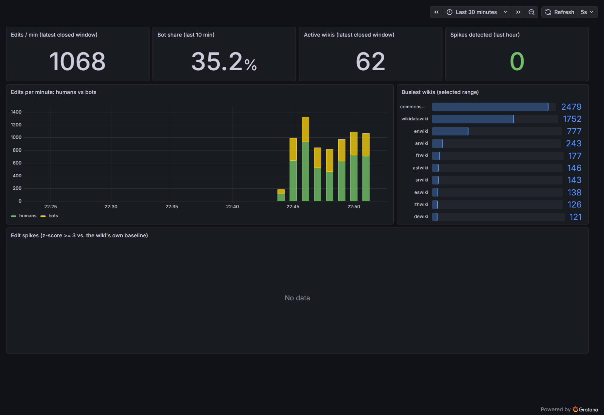
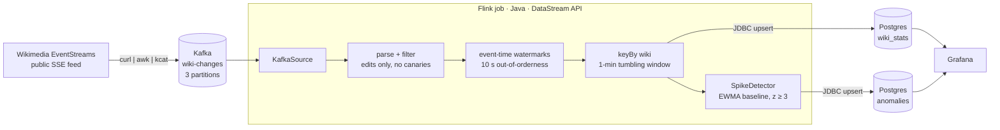

# wikistream

[](https://github.com/DorukMaltepe/realtime_streaming/actions/workflows/ci.yml)
[](LICENSE)


**Every edit on Wikipedia, counted and checked for anomalies within about a minute.**
wikistream streams the live edit feed of all Wikimedia projects (about 1,000–2,000 edits per
minute) through Kafka into a Java Flink job. The job aggregates edits per wiki and minute in
event time, flags unusual bursts against each wiki's own baseline, and writes the results to
Postgres for a live Grafana dashboard. One command starts everything.

```text
$ docker compose up -d
$ docker compose exec postgres psql -U wiki -c "SELECT * FROM anomalies ORDER BY window_start DESC LIMIT 3"
SAMPLE_OUTPUT
```



## Why

Most streaming demos count words from a file. This project processes a real, unbounded,
out-of-order public feed and handles the things that make stream processing hard in practice:

- **Event time, not arrival time.** Edits are counted in the minute they happened, using
  watermarks, so late data and replays give the same answer
- **Stateful anomaly detection.** Each wiki has its own adaptive baseline kept in Flink keyed
  state. 300 edits a minute is normal for Wikidata and a spike for a small wiki
- **Correct results across restarts.** Idempotent upserts plus replay from Kafka give
  effectively exactly-once tables without distributed transactions
- **Tested against real infrastructure.** The integration test runs the production topology
  against real Kafka and Postgres containers via Testcontainers

## What it computes

| Output | What it contains | Granularity | Where |
|---|---|---|---|
| `wiki_stats` | edits and bot edits | per wiki, per minute | Postgres table + dashboard charts |
| `anomalies` | observed edits, expected edits, z-score | per wiki, per flagged minute | Postgres table + dashboard table |
| Dashboard | edits/min, bot share, active wikis, busiest wikis, spike feed | refreshed every 5 s | http://localhost:3000 |
| Flink UI | job graph, throughput, checkpoints, backpressure | live | http://localhost:8081 |

## Quickstart

Requirements: Docker with Compose v2. No JDK needed, since the job is built inside Docker.

```bash
git clone https://github.com/DorukMaltepe/realtime_streaming.git
cd realtime_streaming
docker compose up -d
```

Open http://localhost:3000. The first full minute appears about 70 seconds after start: the
window has to end, then the 10 s watermark slack has to pass. Spike detection begins after a
5-minute warm-up per wiki.

```bash
docker compose exec postgres psql -U wiki   # query the results directly
docker compose down -v                      # stop and delete all data
```

## Architecture



1. A tiny **producer** container turns Wikimedia's Server-Sent Events into one Kafka message
   per event.
2. **Kafka** decouples ingestion from processing and is the replay log the job rebuilds its
   results from.
3. The **Flink job** parses and filters events, assigns event-time watermarks, counts edits
   per wiki in 1-minute tumbling windows, and feeds every closed window to a stateful
   spike detector.
4. Both result streams are **upserted** into Postgres, and **Grafana** queries them every 5 seconds.

**Deep dive: [docs/architecture.md](docs/architecture.md)** covers the deployment view, the Flink
job graph, a step-by-step timeline of when a window fires, the detector's math and state
machine, failure and restart semantics, the data model, and the test architecture.

## Design decisions

- **Event time with a 10-second watermark bound.** Results describe when edits happened, not
  when they were processed. The bound is the trade-off between tolerating late events and
  delaying every result.
- **Per-wiki adaptive baselines instead of fixed thresholds.** An exponentially weighted
  mean and variance per wiki is three doubles of keyed state, follows daily cycles, and needs no
  history buffer. Warm-up, a minimum count and a σ floor keep small wikis from producing noise.
- **Idempotent sinks over transactional sinks.** Every write is
  `INSERT … ON CONFLICT DO UPDATE` keyed on `(window_start, wiki)`. At-least-once delivery then
  produces exactly-once tables, without XA transactions or Postgres prepared-transaction setup.
- **Replay from the log on a fresh start.** Resuming from committed offsets without window
  state overwrote half-counted minutes with partial counts. Replaying the 6-hour retained topic
  rebuilds windows and baselines exactly. (This bug was found by a restart test, see the
  [deep dive](docs/architecture.md#5-failure-and-restart-semantics).)
- **Boring tools where the logic isn't.** Ingestion is a one-line shell pipeline and the
  dashboard is provisioned Grafana, so the code worth reviewing is the Flink job.

## Testing

`WikiPipelineIntegrationTest` starts Kafka and Postgres with **Testcontainers**, runs the
production topology (`WikiPipeline.build`, the same method `main` uses) on an embedded Flink
cluster, and asserts exact rows in Postgres. It covers six quiet minutes, a 50-edit burst
that must raise exactly one anomaly, and canary, non-edit and malformed events that must be
ignored.

```bash
cd flink-job && mvn verify        # needs JDK 17+ and Docker
```

Without a JDK, run it in a container:

```bash
docker run --rm -v /var/run/docker.sock:/var/run/docker.sock -v "$PWD":/src -w /src/flink-job \
  -e TESTCONTAINERS_HOST_OVERRIDE=host.docker.internal maven:3.9-eclipse-temurin-17 mvn -B verify
```

CI runs the integration test and builds all images on every push.

## Project layout

```
docker-compose.yml          the whole stack
producer/Dockerfile         SSE -> Kafka bridge (curl | awk | kcat)
flink-job/                  Maven project: the Flink job + integration test
  src/main/java/com/wikistream/
    WikiPipeline.java       topology: source, parsing, windows, sinks
    SpikeDetector.java      streaming z-score anomaly detector
postgres/init.sql           schema, shared by compose and the tests
grafana/                    provisioned datasource + dashboard JSON
docs/architecture.md        architecture deep dive with diagrams
```

## Roadmap

- [ ] Resume the SSE stream with `Last-Event-ID` so producer restarts lose no events
- [ ] Emit zero-count windows from timers so quiet wikis get accurate baselines
- [ ] Route late events to a side output and count them instead of dropping them
- [ ] Persist checkpoints to a volume and restore from them instead of replaying the topic
- [ ] Expose Flink and Kafka metrics in Grafana via Prometheus

## License

MIT
