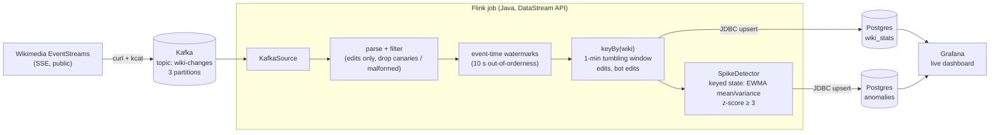

# Real-time Wikipedia edit analytics with Kafka + Flink

[](https://github.com/DorukMaltepe/realtime_streaming/actions/workflows/ci.yml)

A streaming pipeline that ingests **every edit made on Wikipedia and its sister projects, live** (~1,000–2,000 edits per minute). A Java Flink job computes per-wiki, per-minute statistics in event time and flags unusual edit bursts with a streaming anomaly detector. Results land in Postgres and appear on a Grafana dashboard that refreshes every 5 seconds.

One command starts everything: `docker compose up`.


## Architecture



| Component | Role | URL |
|---|---|---|
| `producer` | Bridges Wikimedia's Server-Sent Events stream into Kafka, one JSON event per message | – |
| `kafka` | Apache Kafka 4.2 in KRaft mode (no ZooKeeper) | `kafka:9092` (internal) |
| `jobmanager` / `taskmanager` | Flink 2.2 cluster running the job in application mode (parallelism 2) | http://localhost:8081 |
| `postgres` | Sink for window results and anomalies | `localhost:5432` (wiki / wiki) |
| `grafana` | Provisioned datasource + dashboard, anonymous read access | http://localhost:3000 |

## Quick start

Requirements: Docker with Compose v2. No JDK needed; the job is built inside Docker.

```bash
docker compose up -d
```

Open http://localhost:3000. The first full one-minute window shows up about 70 seconds after start: the window has to close and the 10 s watermark slack has to pass. The spike detector starts alerting after a 5-minute warm-up per wiki.

```bash
docker compose down -v   # stop and delete all data
```

## How it works

**Event time, not processing time.** Windows use the `timestamp` field inside each Wikimedia event, with a 10-second bounded out-of-orderness watermark and source idleness handling. Edits are counted in the minute they happened, not the minute they were processed, so a replay after a restart puts them in the same windows.

**Windowed aggregation.** Events are keyed by wiki (`enwiki`, `wikidatawiki`, …) and counted in 1-minute tumbling windows. An incremental `AggregateFunction` keeps only two counters per window instead of buffering events. A `ProcessWindowFunction` attaches the window start time.

**Anomaly detection.** `SpikeDetector` is a `KeyedProcessFunction` that keeps an exponentially weighted moving mean and variance of each wiki's edits per minute in Flink keyed state. A window is flagged when its z-score against that wiki's own baseline is ≥ 3. Because the baseline is per wiki, *enwiki* and a small regional wiki are each judged against their own normal activity. Guards against noise: a 5-window warm-up, a minimum of 20 edits, and a floor on the standard deviation.

**Delivery guarantees.** Checkpoints every 30 s let Flink recover window state and Kafka offsets together after a task failure. When the job starts fresh (for example after `docker compose restart`), it replays the retained topic from the beginning instead of resuming from committed offsets. Resuming would overwrite half-finished windows with partial counts, because the new job has no window state. The JDBC sinks are at-least-once, but every write is an `INSERT … ON CONFLICT DO UPDATE` keyed on `(window_start, wiki)`, so a replay rewrites the same rows instead of double counting. The result tables are effectively exactly-once without the cost of XA transactions.

## Tests

`WikiPipelineIntegrationTest` uses **Testcontainers** to start real Kafka and Postgres containers. It runs the production topology (the same `WikiPipeline.build(...)` used by `main`) on an embedded Flink mini-cluster and initializes Postgres with the same `postgres/init.sql` that compose uses. The test feeds in a known event sequence: six quiet minutes, then a 50-edit burst, plus a canary, a non-edit event and malformed JSON. It then asserts the exact per-window counts in Postgres and that exactly one anomaly is raised, for the burst minute.

```bash
cd flink-job && mvn verify        # needs JDK 17+ and Docker
```

No JDK installed? Run it in a container instead:

```bash
docker run --rm -v /var/run/docker.sock:/var/run/docker.sock -v "$PWD":/src -w /src/flink-job \
  -e TESTCONTAINERS_HOST_OVERRIDE=host.docker.internal maven:3.9-eclipse-temurin-17 mvn -B verify
```

CI (GitHub Actions) runs the integration test and builds the compose images on every push.

## Project layout

```
docker-compose.yml          the whole stack
producer/Dockerfile         SSE -> Kafka bridge (curl | awk | kcat)
flink-job/                  Maven project: the Flink job + integration test
  src/main/java/com/wikistream/
    WikiPipeline.java       topology: source, parsing, windows, sinks
    SpikeDetector.java      streaming z-score anomaly detector
postgres/init.sql           schema (shared by compose and the tests)
grafana/                    provisioned datasource + dashboard JSON
```

## Design notes

- **Why a shell-pipeline producer?** The ingestion side only reformats SSE frames into Kafka messages. `curl | awk | kcat` does that in one line and reconnects in a loop, so the interesting code lives in Flink.
- **Why Grafana instead of a custom frontend?** It is what production teams use for operational dashboards. The dashboard is checked in as JSON and provisioned automatically, so it is versioned like code.
- **Known limitations:** minutes with zero edits produce no window, so the baseline of a very quiet wiki skews high (fine for busy wikis, documented in `SpikeDetector`). While the producer is down, events are missed: it doesn't resume the SSE stream with `Last-Event-ID`.
