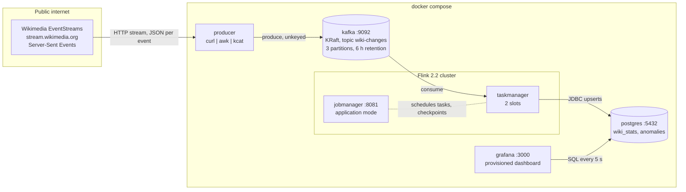
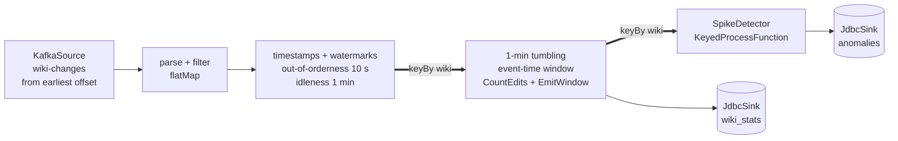
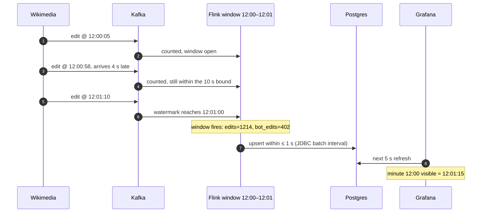
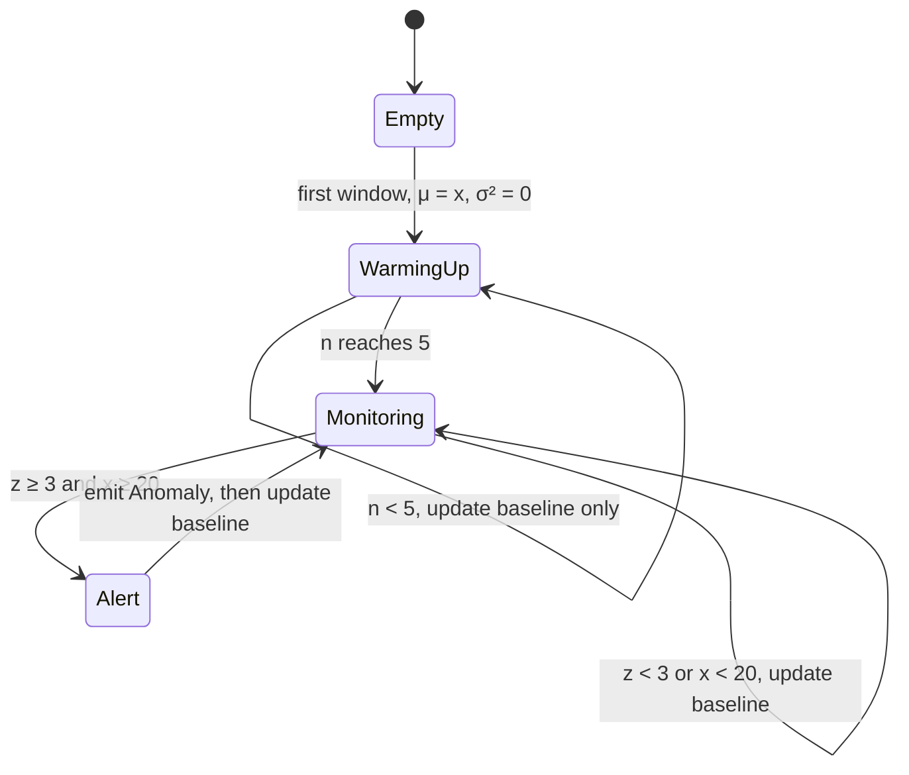
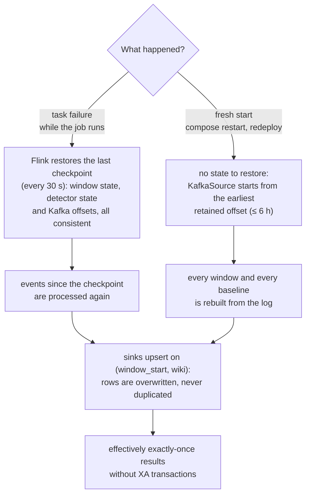
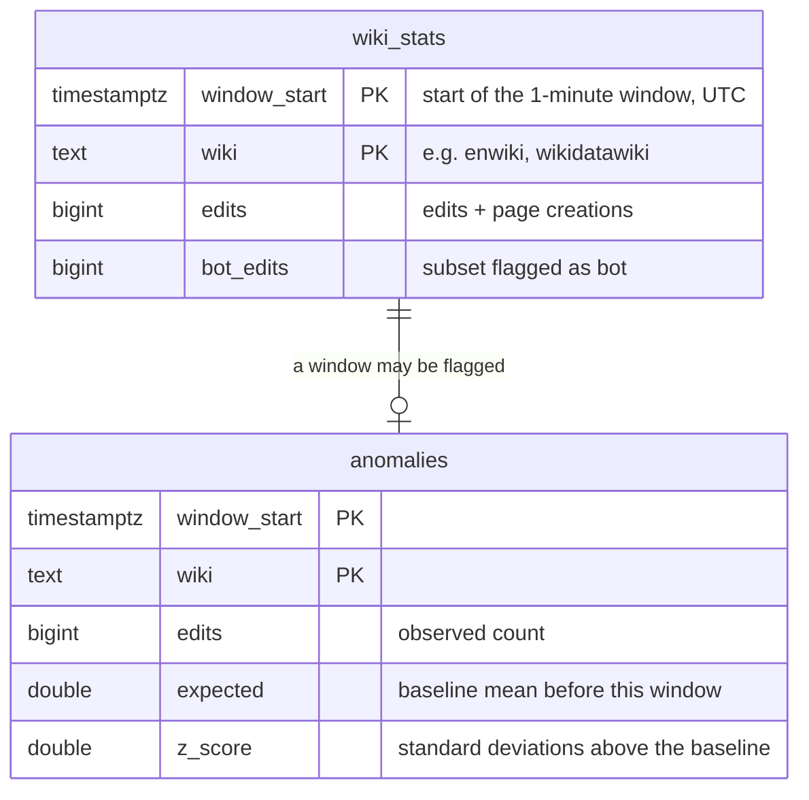
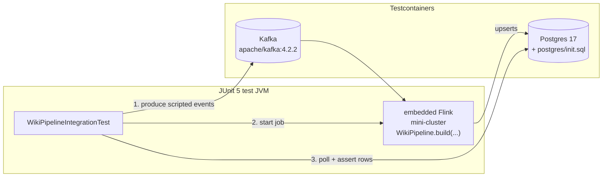

# Architecture

This document explains how wikistream works internally: what runs where, how an event moves
through the system, when a window's result becomes visible, how spikes are detected, and what
happens when something fails.

- [1. System overview](#1-system-overview)
- [2. The Flink job graph](#2-the-flink-job-graph)
- [3. Event time and watermarks](#3-event-time-and-watermarks)
- [4. Spike detection](#4-spike-detection)
- [5. Failure and restart semantics](#5-failure-and-restart-semantics)
- [6. Data model](#6-data-model)
- [7. Test architecture](#7-test-architecture)

## 1. System overview



| Service | Image | Responsibility |
|---|---|---|
| `producer` | `alpine` + `curl` + `kcat` | Opens the Wikimedia SSE stream, strips the `data: ` prefix from each frame and produces one JSON document per Kafka message. Reconnects in a loop because Wikimedia closes long-lived streams. |
| `kafka` | `apache/kafka:4.2.2` | Single-node broker in KRaft mode (no ZooKeeper). Decouples ingestion from processing and serves as the replay log: the Flink job can rebuild all of its results from it. |
| `jobmanager` | built from `flink-job/` | Runs the job's `main()` in application mode, coordinates checkpoints, serves the Flink UI. |
| `taskmanager` | built from `flink-job/` | Executes the operators. Two task slots, job parallelism 2. |
| `postgres` | `postgres:17` | Stores the results. The schema comes from `postgres/init.sql`, the same file the tests use. |
| `grafana` | `grafana/grafana:12.4` | Datasource and dashboard are provisioned from files, so the dashboard is versioned like code. |

Ingestion is a shell pipeline on purpose. Turning SSE frames into Kafka messages is pure
plumbing, so all the logic worth reviewing lives in the Flink job.

## 2. The Flink job graph



Thick arrows are network shuffles (`keyBy`). Everything else is chained into the same task.

| Step | Code | What happens |
|---|---|---|
| Source | `KafkaSource<String>` | Reads raw JSON strings. Three partitions are spread over two source subtasks. |
| Parse + filter | `WikiPipeline.parse` | Keeps only `edit` and `new` events. Drops Wikimedia's synthetic `canary` events, malformed JSON and events without a wiki or timestamp. Output: `WikiEdit(wiki, bot, timestampMs)`. |
| Watermarks | `WatermarkStrategy.forBoundedOutOfOrderness` | Uses the event's own `timestamp`, not arrival time (see [section 3](#3-event-time-and-watermarks)). |
| Window | `TumblingEventTimeWindows` + `CountEdits` + `EmitWindow` | Counts edits and bot edits per wiki and minute. The `AggregateFunction` updates two counters per event instead of buffering the window's events, so state stays at 16 bytes per open window. |
| Detector | `SpikeDetector` | Compares each closed window with that wiki's own baseline (see [section 4](#4-spike-detection)). |
| Sinks | `JdbcSink` (at least once) | Batches writes, flushes at least every second, and uses `INSERT … ON CONFLICT DO UPDATE` so that rewriting a row is harmless. |

`WikiPipeline.build(...)` wires this graph onto any `StreamExecutionEnvironment`. Production
(`main`) and the integration test call the same method, so the test exercises the real topology.

## 3. Event time and watermarks

Wikimedia events arrive out of order and sometimes late, and after a restart the job reprocesses
hours of backlog in seconds. Counting by arrival time would put edits in the wrong minute.
Counting by **event time** gives the same answer however fast or late the data is processed.

A window `[12:00, 12:01)` can only close when Flink is confident no more events for it will
arrive. That confidence is the **watermark**: *highest event time seen − 10 s*.



The trade-off is in one number. A larger out-of-orderness bound tolerates later events but
delays every result by that amount. Ten seconds covers the normal jitter of the Wikimedia stream.
Events later than that are dropped by the window; `allowedLateness` would be the next step if
they mattered. `withIdleness(1 min)` stops an empty partition from holding back the watermark
of the whole job.

## 4. Spike detection

A fixed threshold doesn't work across wikis: 300 edits a minute is a quiet minute for Wikidata
and an extreme one for a small regional wiki. `SpikeDetector` therefore learns a **baseline per
wiki** and alerts on deviations from it, measured in standard deviations (a z-score).

For each closed window with count *x*, using the wiki's state (*n*, *μ*, *σ²*):

```
z      = (x − μ) / max(σ, 1)

alert  if  n ≥ 5  and  x ≥ 20  and  z ≥ 3

update (exponentially weighted, α = 0.2):
  d   = x − μ
  μ  ← μ + α·d
  σ² ← (1 − α)·(σ² + α·d²)
  n  ← n + 1
```



Why these choices:

- **EWMA instead of a sliding window of history.** The state per wiki is three doubles
  (`{n, μ, σ²}` in a `ValueState<double[]>`), whatever the history length, and recent
  behaviour counts more than old behaviour, so the baseline follows daily cycles.
- **Warm-up of 5 windows** so the first minutes of a wiki don't alert against a baseline made of one point.
- **Minimum of 20 edits** so a tiny wiki going from 2 to 7 edits isn't a "spike".
- **σ floored at 1** so a perfectly flat baseline doesn't divide by zero or make any +1 an alert.
- **The alert window still updates the baseline**, so a lasting level shift stops alerting
  after a few minutes instead of alerting forever.

Known limitation: minutes with zero edits produce no window, so for very quiet wikis the baseline
skews high. Emitting zero-count windows from a timer would fix it, at the cost of one timer per
wiki per minute.

## 5. Failure and restart semantics



A fresh start used to resume from the **committed** Kafka offsets. That looked right, but it was
a bug: the new job has no window state, so the minute that was half-counted before the restart
was counted again from the middle, and the upsert **overwrote** the full count with a partial
one. Replaying the retained topic from the start rebuilds that state exactly. Six hours of
Wikipedia is roughly 500k events, which Flink replays far faster than real time.

What is not covered: while the `producer` container is down, Wikimedia events are not captured.
The stream supports resuming with a `Last-Event-ID` header, which the producer doesn't use yet.

## 6. Data model



The primary key `(window_start, wiki)` is both the upsert target that makes writes idempotent and
the index the dashboard's time-range queries use.

## 7. Test architecture



The test writes a scripted sequence to Kafka:

| Input | Expected result |
|---|---|
| 6 quiet minutes, 5 edits each, 1 of them by a bot | 6 rows in `wiki_stats` with `edits=5, bot_edits=1` |
| 1 minute with 50 page creations | a row with `edits=50` **and** exactly one row in `anomalies` |
| a `canary` event, a `log` event, `not json` | ignored: counts stay exact |
| an event 4 minutes later on another wiki | moves the watermark forward so every window above closes |

It then runs the real topology on an embedded Flink cluster and asserts on the exact rows in
Postgres. Because both containers are real, the test also covers serialization, the Kafka
connector, the JDBC driver, the SQL and the schema, which mocks would skip.
